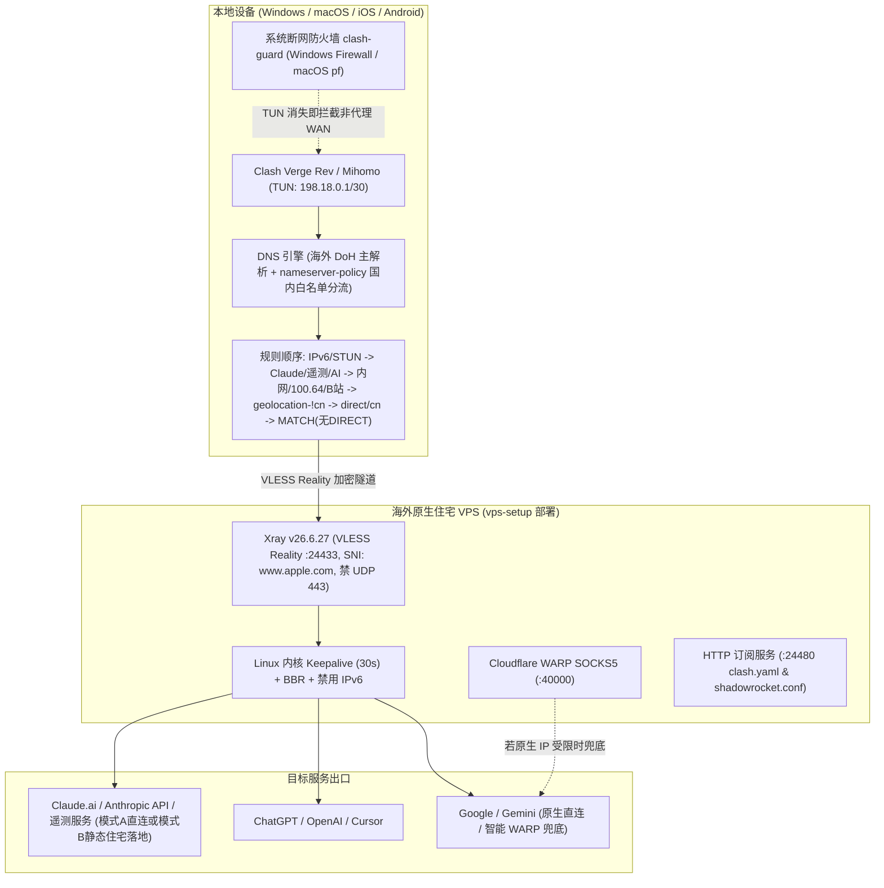

# 海外独享 VPS 终极防漏防封网络全自动化搭建技能 (vps-setup)

## 技能概述

本技能为 AI Agent 及用户提供了**一键全自动初始化海外 VPS 并构建本地终极防漏网络环境**的完整工程方案，专门解决国内用户访问海外 AI 服务（Claude、ChatGPT、Gemini、Cursor 等）时的高频痛点：

* **账号封禁 / 区域阻断**：利用独享纯净美区原生住宅 IP（模式 A）或「高速跳板 + 静态住宅 SOCKS5 落地」（模式 B `dialer-proxy`），建立高信誉固定出口；
* **策略组零回落锁死**：`🚀 独享-AI与代码`、`🌐 谷歌与Gemini`、`🐟 漏网之鱼`（及模式 B `🔀 跳板节点`）**彻底移除 `DIRECT`**，节点故障即断网，杜绝任何情况下回落本地直连；
* **海外 DoH 优先与零 DNS 泄漏**：`respect-rules: true` 配合海外 DoH 主 `nameserver`，通过 `nameserver-policy` 将 `geosite:geolocation-!cn` 优先锁定海外解析、仅国内白名单（`geosite:cn,private` / `rule-set:direct`）和节点域名走国内 DNS；全阻断 IPv6（`IP-CIDR6,::/0,REJECT`）与 WebRTC STUN 旁路（`3478/5349/19302`）；
* **每日自动更新国内白名单**：接入 `Loyalsoldier/clash-rules`（`direct.txt` / `cncidr.txt`），保留 `100.64.0.0/10`、B 站 `mirrorakam`、微信直连，并将 `GEOSITE,geolocation-!cn` 与 Claude 全生态/第三方遥测域名（含 `claudemcpclient.com`、`statsig`、`datadoghq`、`googletagmanager`）前置在白名单之前；
* **系统级断网开关（Kill Switch）**：提供 `setup_killswitch.py`（Windows 防火墙 + 任务计划 `local.clash-guard` / macOS `pf` `com.apple/clash-guard` + `launchd`），采用「**开机默认放行 → 开启 TUN 自动设防 → 异常掉线保持锁死（0ms 拦截 + 禁 IPv6 + 禁局域网路由器 DNS 53/853）→ 重启自动归零**」三态机制，含完整备份、一键还原与 `断网急救.txt`；
* **服务端防断流与兼容加固**：锁定 **Xray v26.6.27** (`"minClientVer": ""`, SNI `www.apple.com`)、内核 `tcp_keepalive_time` (30s) + BBR + Xray `connIdle` (1800s) 根除长思考 `Broken pipe`、VPS 封禁 UDP 443 (QUIC)、内置 Cloudflare WARP 本地代理 (`127.0.0.1:40000`) 兜底 Gemini；
* **全平台防漏输出**：同步生成本地 Clash `.yaml`、iOS 小火箭 `.shadowrocket.conf`（`FINAL,PROXY` + `surge-rules`）、`vless://` 分享链接与服务端 `24480` 端口订阅。

---

## 核心架构拓扑



---

## 目录结构说明

* `scripts/deploy_vps.py`：**【主入口】** 本地端一站式全自动编排器（SSH/SFTP 远端部署 → 生成本地 Clash YAML 与 Shadowrocket `.conf` → 默认自动生成桌面 `断网急救.txt` 并启用系统级断网防火墙 `local.clash-guard`，全程不修改 Clash Verge 既有订阅；支持 `--mode A|B` 与 `--no-killswitch`）。
* `scripts/vps_setup.sh`：VPS 服务端静默初始化脚本（内核调优、Xray v26.6.27、WARP、iptables、HTTP 订阅服务提供 `clash.yaml` 与 `shadowrocket.conf`，输出标准 JSON）。
* `scripts/generate_clash_config.py`：本地配置生成器（输出无 `DIRECT` 策略组的 Clash YAML、iOS `.shadowrocket.conf` 与 `vless://` 链接，支持模式 A/B）。
* `scripts/setup_killswitch.py`：本地客户端只读体检（`audit`）、备份与 `断网急救.txt` 生成（`backup`）、Clash Verge 全局开关加固（`harden-client`，**绝不触碰任何订阅文件**）及跨平台系统断网防火墙安装/解除（`install-killswitch` / `remove-killswitch`，Windows 下非管理员时自动拉起 UAC 提权）。
* `scripts/verify_environment.py`：只读 11 项防漏验收门禁（静态 YAML 审计、无代理环境变量真 TUN 接管测试、国内直连核验、海外出口与遥测一致性、真实 DNS 泄漏与纯 IP `1.1.1.1` 测试、断网开关状态检查）。
* `templates/clash_profile.yaml.template`：终极防漏 Clash Verge / Mihomo 配置模板。
* `templates/shadowrocket.conf.template`：iOS Shadowrocket（小火箭）白名单 + `FINAL,PROXY` 防漏配置模板。
* `templates/xray_server.json.template`：Xray 服务端配置模板。

---

## 新 VPS 一键复刻与全自动防漏执行流程

当你购买了新 VPS 并获得 IP、SSH 端口、密码后，有两种操作方式：

### 方式 1：直接在对话框交给 Agent（最推荐）
在对话框发送新 VPS 的凭证，例如：
> “我新买了一台海外 VPS，IP 是 `x.x.x.x`，端口是 `xxxx`，密码是 `xxxx`，请用 vps-setup 技能帮我完成节点的配置。”

若需搭配静态住宅 SOCKS5 走链式代理（模式 B），也可直接发送：
> “我新买了一台海外 VPS（IP `x.x.x.x`，端口 `xxxx`，密码 `xxxx`）和一颗静态住宅 SOCKS5（IP `y.y.y.y`，端口 `1080`，账号 `user`，密码 `pass`），请用 vps-setup 模式 B 帮我完成配置。”

**Agent 自动执行闭环（无需中途反复向用户确认）**：
1. **运行主入口脚本**：调用 `scripts/deploy_vps.py`，全自动完成「远端 VPS 初始化 → 生成本地无 `DIRECT` `.yaml` 与 `.shadowrocket.conf` → 自动执行 `setup_killswitch.py --action install-killswitch --skip-backup` 生成桌面 `断网急救.txt` 并安装按需断网防火墙 `local.clash-guard`（Windows 自动弹窗 UAC 提权）」，全程**绝不修改或读取本机 Clash Verge 既有订阅文件**。
   * 断网防火墙默认待命：电脑重启或未开启 TUN 时保持正常上网；一旦用户点击开启 Clash Verge TUN 按钮即自动锁死外网旁路，异常掉线不解除，重启后自动归零。
2. **运行只读防漏门禁**：调用 `scripts/verify_environment.py --config <新生成的YAML>` 校验配置静态合规性、真 TUN 接管、国内直连、海外与遥测一致、真实 DNS 无泄漏以及断网防火墙就绪状态。

### 方式 2：在本地终端一键执行 Python 脚本（模式 A & 模式 B）

**模式 A（VPS 直接作为海外出口，适合 9929/CN2 等优质线路原生 VPS）：**
```powershell
python ".agents/skills/vps-setup/scripts/deploy_vps.py" `
  --host <新VPS_IP> --port <SSH端口> --user root --password "<新VPS密码>" `
  --node-name "🇺🇸 独享-Claude-原生住宅-02" `
  --output "Claude-US-Residential-New.yaml"
```
> 若仅需生成配置文件而暂不动系统防火墙，可附加 `--no-killswitch`。

**模式 B（VPS 做高速跳板 + 静态住宅 SOCKS5 落地，支持已有 JSON/参数本地生成）：**
```powershell
python ".agents/skills/vps-setup/scripts/generate_clash_config.py" `
  --ip <跳板VPS_IP> --port 24433 --uuid "<UUID>" --public-key "<PBK>" --short-id "<SID>" `
  --mode B --socks5-server <住宅SOCKS5_IP> --socks5-port <端口> `
  --socks5-user "<账号>" --socks5-pass "<密码>" `
  --output "Claude-US-Chained.yaml"
```

### 方式 3：手动按需执行只读体检、断网防火墙管理与防漏验收

> **安全边界**：`setup_killswitch.py` **绝不修改任何 Clash Verge 订阅文件（`profiles/` 或 `profiles.yaml`）**；安装断网开关前必须确认 TUN 虚拟网卡已处于启动状态。

```powershell
# 1. 只读体检（安全无副作用）
python ".agents/skills/vps-setup/scripts/setup_killswitch.py" --action audit

# 2. 手动开启系统级断网开关（--skip-backup 不读取 Clash Verge 目录；Windows 会自动拉起 UAC 提权）
python ".agents/skills/vps-setup/scripts/setup_killswitch.py" --action install-killswitch --skip-backup

# 3. 临时解除系统级断网开关
python ".agents/skills/vps-setup/scripts/setup_killswitch.py" --action remove-killswitch

# 4. 运行只读 11 项防漏实测门禁
python ".agents/skills/vps-setup/scripts/verify_environment.py" --config "Claude-US-Residential-New.yaml"
```

---

## 客户端导入指引

1. **电脑端（Windows / Mac - Clash Verge Rev）**：
   * 拖拽生成的 `.yaml` 文件进 **订阅 (Profiles)**，使用时直接右键选择对应订阅并打开 **TUN 模式** 按钮即可（无需开启 Clash Verge 开机自启，可完全自由控制客户端启停）；
   * 在设置中确认 **DNS 覆写** 与 **IPv6** 开关保持关闭（避免覆盖 YAML 防漏配置）。
2. **手机端（iOS - Shadowrocket）**：
   * 先添加生成的 `vless://...` 节点并选中；
   * 再将生成的 `.shadowrocket.conf`（或 `http://<VPS_IP>:24480/shadowrocket.conf`）导入 **配置** 页并点 **使用配置**，首页保持「全局路由 = 配置」。
3. **手机端（Android - Clash Meta for Android）**：
   * 打开 App -> **配置** -> **新配置** -> **从 URL 导入**：`http://<VPS_IP>:24480/clash.yaml`。
