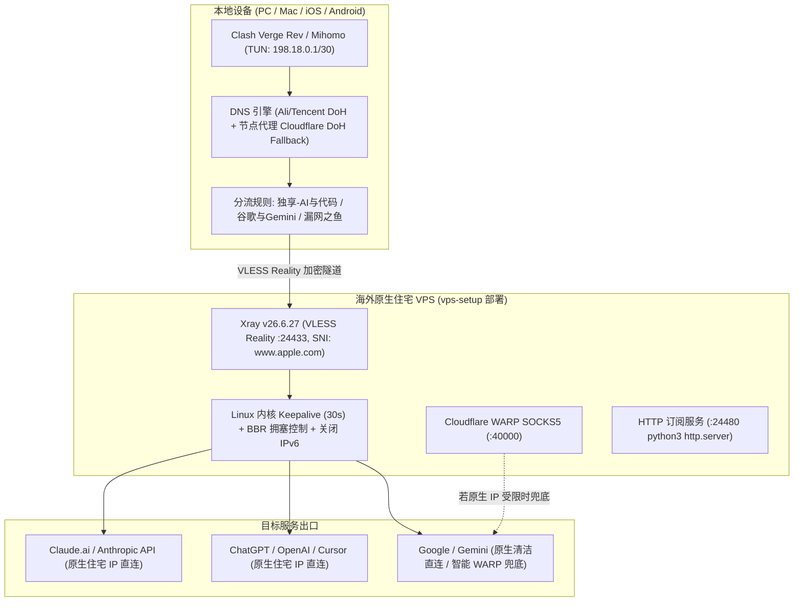

# 海外独享 VPS 防封网络全自动化搭建技能 (vps-setup)

## 技能概述

本技能为 AI Agent 及用户提供了**一键全自动初始化海外 VPS 并生成客户端配置文件**的完整工程方案。
专门解决国内用户访问海外 AI 服务（Claude、ChatGPT、Gemini、Cursor 等）时的高频痛点：
* **账号封禁 / 区域阻断**：利用独享纯净美区原生住宅 IP，建立极高发卡地信誉；
* **Gemini / Google "ZZ" 限制**：服务端内置 Cloudflare WARP 本地代理，按需智能分流或原生直连；
* **长文本深度思考掉线**：优化内核 `tcp_keepalive_time` (30s) 与 Xray `connIdle` (1800s)，根除 `Broken pipe (os error 32)`；
* **Mihomo / Clash Verge 握手失败**：锁定 **Xray v26.6.27** 并开启 `"minClientVer": ""`，规避后量子加密协商失败（`REALITY authentication failed`）；SNI 锁定 **`www.apple.com`**，杜绝证书链超长分片丢包；
* **DNS 启动死锁与泄漏**：国内 DoH 作为 bootstrap，境外 DoH 走节点代理，全阻断 IPv6 与 WebRTC STUN 旁路。

---

## 核心架构拓扑



---

## 目录结构说明

本技能目录结构如下：
* `scripts/deploy_vps.py`：**【主入口】** 本地端全自动一键远程编排器（Python/SSH 自动 SFTP 上传、远程执行并回传生成本地 YAML）。
* `scripts/vps_setup.sh`：VPS 服务端静默初始化脚本（内核调优、Xray 锁定、WARP、iptables、HTTP 订阅，输出标准 JSON）。
* `scripts/generate_clash_config.py`：本地客户端配置生成器（生成 1:1 匹配生产标准的 Clash Verge YAML 与分享链接）。
* `scripts/verify_environment.py`：端到端连通性与防泄漏检测门禁。
* `templates/clash_profile.yaml.template`：标准 Clash Verge / Mihomo 配置模板。

---

## 新 VPS 一键复刻使用指南

当你购买了新 VPS 并获得 IP、SSH 端口、密码后，有两种操作方式：

### 方式 1：直接在对话框交给 Agent（最推荐）
在对话框发送新 VPS 的凭证，例如：
> “我新买了一台海外 VPS，IP 是 `x.x.x.x`，端口是 `xxxx`，密码是 `xxxx`，请用 vps-setup 技能帮我完成节点的配置。”
（或者：“请用 vps-setup 帮我配置成和现在一样的节点。”）

Agent 将自动调用该技能，远程连接新服务器并全自动初始化，直接在当前工作区生成专属的 Clash 配置文件及 iOS 小火箭直连链接。

### 方式 2：在本地终端一键执行 Python 脚本
在当前项目目录下的终端中直接运行：

```powershell
python "skills/vps-setup/scripts/deploy_vps.py" `
  --host <新VPS_IP> `
  --port <SSH端口> `
  --user root `
  --password "<新VPS密码>" `
  --node-name "🇺🇸 独享-Claude-原生住宅-02" `
  --output "Claude-US-Residential-New.yaml"
```

该脚本将全自动完成：
1. SSH SFTP 安全上传并执行 `vps_setup.sh`；
2. 调优内核（TCP Keepalive 30s、BBR、禁用 IPv6）；
3. 安装并锁定 Xray v26.6.27 与 Reality；
4. 配置 Cloudflare WARP 备用代理（端口 40000）；
5. 启动开机自启 HTTP 订阅服务（端口 24480）；
6. 自动读取服务端生成的密钥，在本地直接输出完整的 Clash Verge 配置文件与移动端链接。

---

## 客户端导入指引

1. **电脑端（Windows / Mac - Clash Verge Rev）**：
   * 打开 **Clash Verge Rev** -> 点击左侧 **订阅 (Profiles)**；
   * 将生成的 `.yaml` 文件直接拖拽进窗口，右键该配置卡片选择 **使用 (Use)**；
   * 确保左下角的 **系统代理** 与 **TUN 模式** 开启即可。
2. **手机端（Android - Clash Meta for Android）**：
   * 打开 App -> **配置** -> **新配置** -> **从 URL 导入**；
   * 填写：`http://<新VPS_IP>:24480/clash.yaml` 保存即可。
3. **手机端（iOS - Shadowrocket / Sing-box / Loon）**：
   * 复制生成的 `vless://...` 链接，打开 Shadowrocket 即可自动添加。
