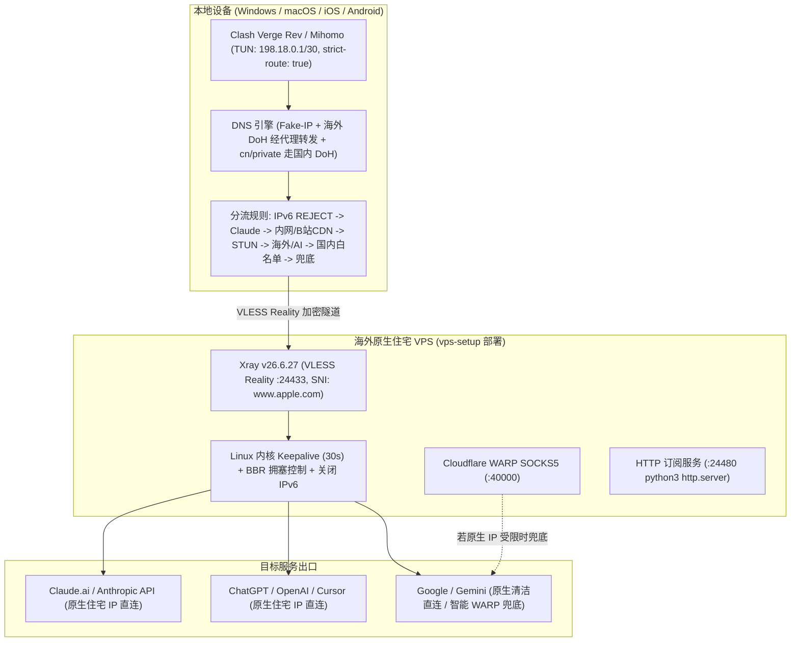

# 海外独享 VPS 防封网络全自动化搭建技能 (vps-setup)

## 技能概述

本技能为 AI Agent 及用户提供了**一键全自动初始化海外 VPS 并生成客户端配置文件**的完整工程方案。
专门解决国内用户访问海外 AI 服务（Claude、ChatGPT、Gemini、Cursor 等）时的高频痛点：
* **账号封禁 / 区域阻断**：利用独享纯净美区原生住宅 IP，建立极高发卡地信誉；
* **Gemini / Google "ZZ" 限制**：服务端内置 Cloudflare WARP 本地代理，按需智能分流或原生直连；
* **长文本深度思考掉线**：优化内核 `tcp_keepalive_time` (30s) 与 Xray `connIdle` (1800s)，根除 `Broken pipe (os error 32)`；
* **Mihomo / Clash Verge 握手失败**：锁定 **Xray v26.6.27** 并开启 `"minClientVer": ""`，规避后量子加密协商失败（`REALITY authentication failed`）；SNI 锁定 **`www.apple.com`**，杜绝证书链超长分片丢包；
* **DNS 与 IPv6 防泄漏**：默认 `nameserver` 走经节点转发的 `1.1.1.1` / `8.8.8.8` 海外 DoH，仅通过 `nameserver-policy` 让 `rule-set:direct` 与 `geosite:cn,private` 走国内 DoH；配合 `tun.strict-route: true` + `dns.ipv6: false` + 顶层 `IP-CIDR6,::/0,REJECT,no-resolve` 与策略组移除 `DIRECT`；
* **规则顺序与白名单自动更新**：通过 `rule-providers` 每日自动更新 `Loyalsoldier/clash-rules` 国内白名单（`direct.txt` + `cncidr.txt`），并将内网保留地址（`private` / `lan` / `100.64.0.0/10`）与 B 站 CDN（`mirrorakam`）置于 `DST-PORT,3478` 和 `GEOSITE,geolocation-!cn` 之前，防止被上游规则架空。

---

## 核心架构拓扑



---

## 目录结构说明

本技能目录结构如下：
* `scripts/deploy_vps.py`：**【主入口】** 本地端全自动一键远程编排器（Python/SSH 自动 SFTP 上传、远程执行、回传生成本地 YAML & `.conf`，并在 Windows 上主动关闭 SMHNR、在 macOS 上输出只读防泄漏提示）。
* `scripts/vps_setup.sh`：VPS 服务端静默初始化脚本（内核调优、Xray 锁定、WARP、iptables、HTTP 订阅，输出标准 JSON）。
* `scripts/generate_clash_config.py`：本地客户端配置生成器（生成 1:1 匹配生产标准的 Clash Verge YAML、iOS Shadowrocket `.conf` 与分享链接）。
* `scripts/windows_smhnr.py`：Windows SMHNR（智能多宿主名称解析）状态检测、主动关闭、一键复原及桌面复原 `.bat` 生成工具（非 Windows 平台自动跳过）。
* `scripts/verify_environment.py`：端到端连通性与真实防泄漏检测门禁（含 `bash.ws` DNS 泄露实测、IPv6 旁路阻断实测、Windows SMHNR 核查及 macOS 只读提示）。
* `templates/clash_profile.yaml.template`：标准 Clash Verge / Mihomo 配置模板。

---

## 新 VPS 一键复刻使用指南

当你购买了新 VPS 并获得 IP、SSH 端口、密码后，有两种操作方式：

### 方式 1：直接在对话框交给 Agent（最推荐）
在对话框发送新 VPS 的凭证，例如：
> “我新买了一台海外 VPS，IP 是 `x.x.x.x`，端口是 `xxxx`，密码是 `xxxx`，请用 vps-setup 技能帮我完成节点的配置。”
（或者：“请用 vps-setup 帮我配置成和现在一样的节点。”）

Agent 执行本技能时，必须遵守以下平台行为规范：
1. 远程初始化 VPS 并在本地生成 Clash `.yaml`、Shadowrocket `.conf` 与 `vless://` 链接；
2. **Windows 环境（必须主动处理 SMHNR）**：
   * 主动运行 `scripts/windows_smhnr.py --disable --restore-bat "%USERPROFILE%\Desktop\复原Windows-SMHNR.bat"`（或在向用户说明 UAC 提权后协助执行关闭命令），将 `HKLM\SOFTWARE\Policies\Microsoft\Windows NT\DNSClient\DisableSmartNameResolution` 设为 `1` 并刷新 DNS 缓存，同时在桌面提供一键复原 `.bat`；
   * 不要修改 Clash Verge Rev 的全局配置或其他已有订阅，保持 Clash Verge 设置中的「DNS 覆写」与「IPv6」开关关闭。
3. **macOS 环境（仅做提示，绝不主动修改系统网络设置）**：
   * macOS **没有** Windows SMHNR 机制（由 `mDNSResponder` 按 `scutil --dns` 顺序解析），无需执行关闭 SMHNR 操作；
   * **禁止主动修改用户的 macOS IPv6 或网络服务设置**；但**必须向用户清晰提示**以下事项，由用户自行决定是否调整：
     1. macOS 没有 Windows 的 WFP，当本地 Wi-Fi/路由器分配公网 IPv6 且 Mihomo 顶层为 `ipv6: false` 时，原生 IPv6 流量可能绕过 `utun` 泄露；如需彻底避免，用户可自行决定是否在「系统设置 → 网络 → Wi-Fi → 详细信息 → TCP/IP」将「配置 IPv6」设为「仅本地链路（Link-local only）」（注意：此设置会影响纯 IPv6 内网站点访问，因此仅作提示、不代用户关闭）；
     2. 提醒用户开启 TUN 后可在终端运行 `scutil --dns`，确认 `resolver #1` 指向 `198.18.0.2`，排查 Tailscale MagicDNS（`100.100.100.100`）或 iCloud 专用代理（Private Relay）抢占 DNS；
     3. 提醒保持 Clash Verge Rev 设置里的「DNS 覆写」与「IPv6」开关关闭。
4. 客户端导入并开启 TUN 后，可运行 `scripts/verify_environment.py` 完成端到端防泄漏实测验收。

### 方式 2：在本地终端一键执行 Python 脚本
在当前项目目录下的终端中直接运行：

```powershell
python "skills/vps-setup/scripts/deploy_vps.py" `
  --host <新VPS_IP> `
  --port <SSH端口> `
  --user root `
  --password "<新VPS密码>" `
  --node-name "🇺🇸 独享-Claude-原生住宅-02" `
  --output "Claude-US-Residential-New.yaml"
```

该脚本将全自动完成：
1. SSH SFTP 安全上传并执行 `vps_setup.sh`；
2. 调优内核（TCP Keepalive 30s、BBR、禁用 IPv6）；
3. 安装并锁定 Xray v26.6.27 与 Reality；
4. 配置 Cloudflare WARP 备用代理（端口 40000）；
5. 启动开机自启 HTTP 订阅服务（端口 24480）；
6. 自动读取服务端生成的密钥，在本地直接输出完整的 Clash Verge `.yaml`、Shadowrocket `.conf` 与移动端链接；
7. 在 **Windows** 上自动调用 `windows_smhnr.py --disable` 关闭 SMHNR 并在桌面生成 `复原Windows-SMHNR.bat`（可加 `--skip-smhnr` 跳过）；在 **macOS** 上仅打印防泄漏提示，不修改任何系统设置。

---

## 客户端导入与平台防泄漏指引

1. **Windows（Clash Verge Rev）**：
   * 打开 **Clash Verge Rev** -> 点击左侧 **订阅 (Profiles)**，将生成的 `.yaml` 拖入窗口并启用；
   * 确认设置页的 **「DNS 覆写」** 与 **「IPv6」** 保持关闭，开启 **服务模式** 与 **TUN 模式**（新版 Mihomo + `strict-route: true` 会通过 Windows WFP 自动阻断公网 IPv6 旁路）；
   * **SMHNR 已由技能自动关闭**；如需随时复原，双击桌面 `复原Windows-SMHNR.bat` 或运行 `python scripts/windows_smhnr.py --restore`。
2. **macOS（Clash Verge Rev）**：
   * 导入 `.yaml` 并启用，安装服务模式并开启 **TUN 模式**，确认设置页 **「DNS 覆写」** 与 **「IPv6」** 关闭；
   * **无需关闭 SMHNR**；是否将 Wi-Fi 的 IPv6 改为「仅本地链路（Link-local only）」由用户自行权衡（若需访问校园网纯 IPv6 资源请保持默认），并建议用 `scutil --dns` 核查主 DNS 是否指向 `198.18.0.2`。
3. **手机端（Android - Clash Meta for Android）**：
   * 打开 App -> **配置** -> **新配置** -> **从 URL 导入**；
   * 填写：`http://<新VPS_IP>:24480/clash.yaml` 保存即可。
4. **手机端（iOS - Shadowrocket / Sing-box / Loon）**：
   * 复制生成的 `vless://...` 链接，打开 Shadowrocket 添加节点并选中；
   * 进入 **配置 (Config)** -> **从 URL 添加配置**，填写 `http://<新VPS_IP>:24480/shadowrocket.conf`（或导入本地生成的 `.conf` 文件）并启用，即可获得与桌面端一致的防泄漏规则。

---

## 端到端防泄漏验收命令

在客户端开启 TUN 模式后，直接运行（默认绕过代理环境变量直测 TUN 链路）：

```powershell
python "skills/vps-setup/scripts/verify_environment.py"
```

验收覆盖：美区出口 IP、Claude / Anthropic 边缘连通性、Gemini 无 `ZZ` 拦截、`bash.ws` 真实 DNS 泄露测试（0 中国大陆 DNS）、IPv6 字面量阻断测试与 `AAAA` 抑制检查，以及 Windows SMHNR 状态 / macOS 只读 DNS 提示。
